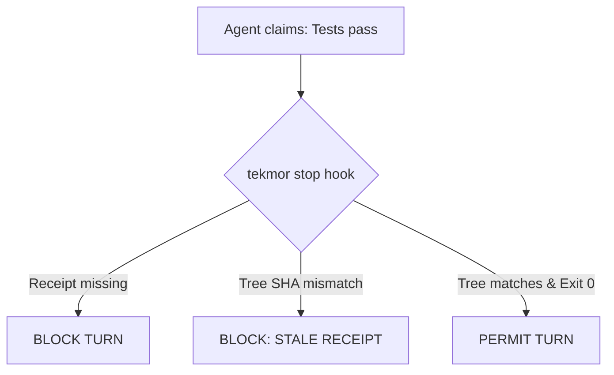

# Caveman Docs & Animated Changelog Specification

Developer tools require documentation that acts as a precision technical manual and a changelog that communicates continuous engineering velocity.

---

## 1. Caveman.so Documentation Style Guide

Follow these layout patterns derived from `docs.caveman.so`:

### A. Host Compatibility Matrix Table
Tabulate environments clearly so engineers immediately see where gates are active:

| Host Environment | Gate Mode | Implementation Details |
|---|---|---|
| **Claude Code** | Active Gates | Registers native Stop Hook via `tekmor install` |
| **Cursor / Codex** | Passive Receipts | Run `tekmor verify -- <cmd>` in integrated terminal |
| **GitHub Actions / CI** | Enforced Gates | `tekmor verify receipt --strict` in pipeline step |

### B. Command Reference Matrix
Structure CLI references by flags, env overrides, and defaults:

| Flag / Option | Type | Default | Description |
|---|---|---|---|
| `--repeat <N>` | integer | `1` | Runs allowlisted command N times on same tree to detect flakiness |
| `--timeout <sec>` | integer | `60` | Max seconds before subprocess is SIGKILL'd |
| `--receipt <path>` | string | `.verify/receipt.json` | Path to store the cryptographic tree receipt |

### C. Mermaid Architecture Diagrams
Use plain text Mermaid flowcharts rendered with dark theme overrides:



---

## 2. Animated Scroll-Tracking Changelog Timeline

A signature feature of high-craft developer sites: a vertical timeline rail with a glowing green progress dot that travels down the rail as the user scrolls, lighting up version nodes.

### Component Implementation (`ChangelogTimeline.svelte`)

```svelte
<script lang="ts">
  import { onMount } from 'svelte';

  let timelineContainer: HTMLElement | undefined = $state();
  let indicatorY = $state(0);
  let activeVersion = $state('');

  function updateScroll() {
    if (!timelineContainer) return;
    const rect = timelineContainer.getBoundingClientRect();
    const focusY = window.innerHeight * 0.35;
    const relativeY = focusY - rect.top;
    const maxH = Math.max(0, rect.height - 36);
    indicatorY = Math.max(0, Math.min(relativeY, maxH));

    const cards = timelineContainer.querySelectorAll<HTMLElement>('[data-version]');
    let closestVer = '';
    let closestDist = Infinity;

    cards.forEach((card) => {
      const cardRect = card.getBoundingClientRect();
      const dist = Math.abs(cardRect.top - focusY);
      if (dist < closestDist) {
        closestDist = dist;
        closestVer = card.getAttribute('data-version') || '';
      }
    });

    if (closestVer) activeVersion = closestVer;
  }

  $effect(() => {
    updateScroll();
    window.addEventListener('scroll', updateScroll, { passive: true });
    window.addEventListener('resize', updateScroll, { passive: true });
    return () => {
      window.removeEventListener('scroll', updateScroll);
      window.removeEventListener('resize', updateScroll);
    };
  });
</script>

<div bind:this={timelineContainer} class="relative max-w-4xl pb-12">
  <!-- Static Rail Line -->
  <div class="pointer-events-none absolute left-[15px] sm:left-[19px] top-4 bottom-4 w-[2px] bg-white/[0.08]"></div>

  <!-- Dynamic Active Progress Beam -->
  <div
    class="pointer-events-none absolute left-[15px] sm:left-[19px] top-4 w-[2px] bg-gradient-to-b from-[#5fd39a] via-emerald-400 to-[#5fd39a]"
    style="height: {indicatorY}px; transition: height 0.08s linear;"
  ></div>

  <!-- Traveling Glowing Indicator Dot -->
  <div
    class="pointer-events-none absolute left-[10px] sm:left-[14px] top-4 z-20 h-3 w-3 rounded-full bg-[#5fd39a] shadow-[0_0_14px_#5fd39a] ring-4 ring-[#070709]"
    style="transform: translateY({indicatorY}px); transition: transform 0.08s linear;"
  ></div>

  <!-- Version Entries -->
  <div class="space-y-14 pl-10 sm:pl-14">
    <!-- Version cards with data-version="1.0.0" -->
  </div>
</div>
```

### Standard Category Badges
- `Added` (`bg-[#5fd39a]/10 text-[#5fd39a] border-[#5fd39a]/30`)
- `Changed` (`bg-blue-500/10 text-blue-400 border-blue-500/30`)
- `Fixed` (`bg-amber-500/10 text-amber-300 border-amber-500/30`)
- `Security` (`bg-purple-500/10 text-purple-300 border-purple-500/30`)
- `Migration` (`bg-rose-500/10 text-rose-300 border-rose-500/30`)
